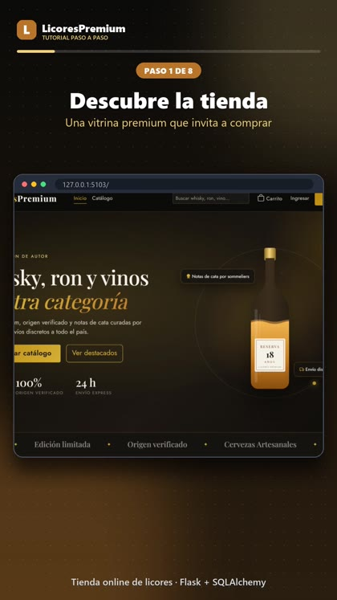
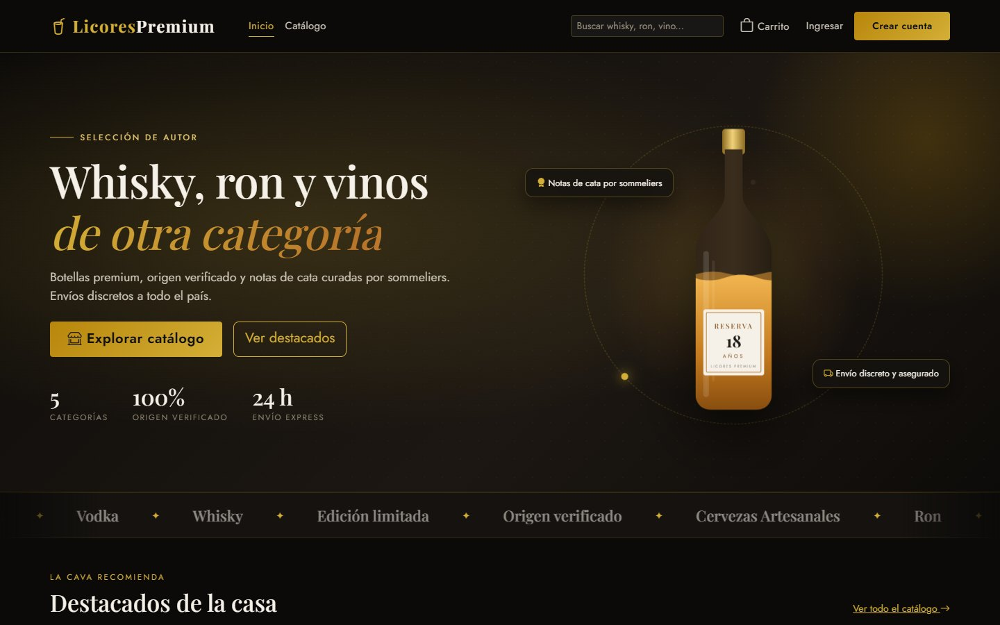
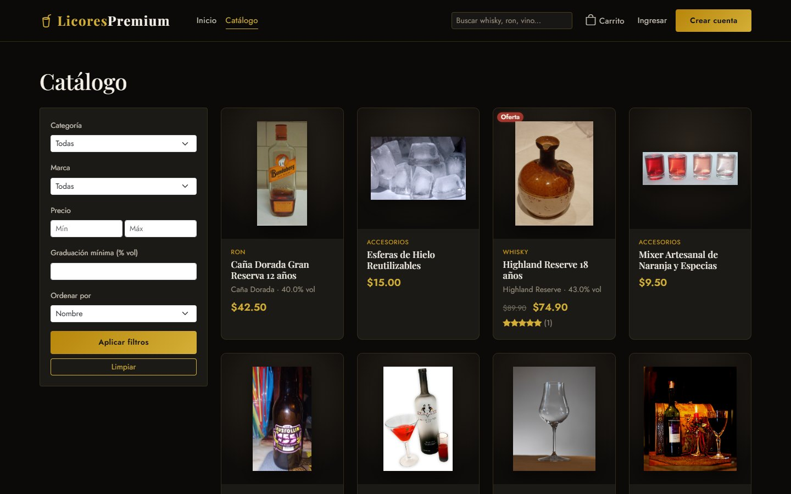
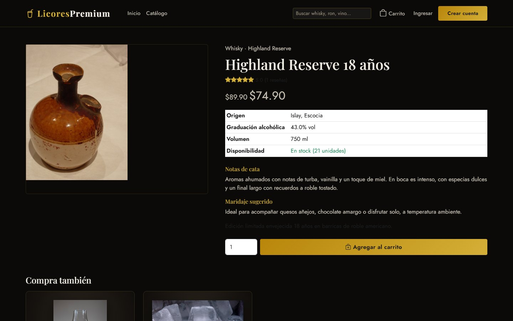
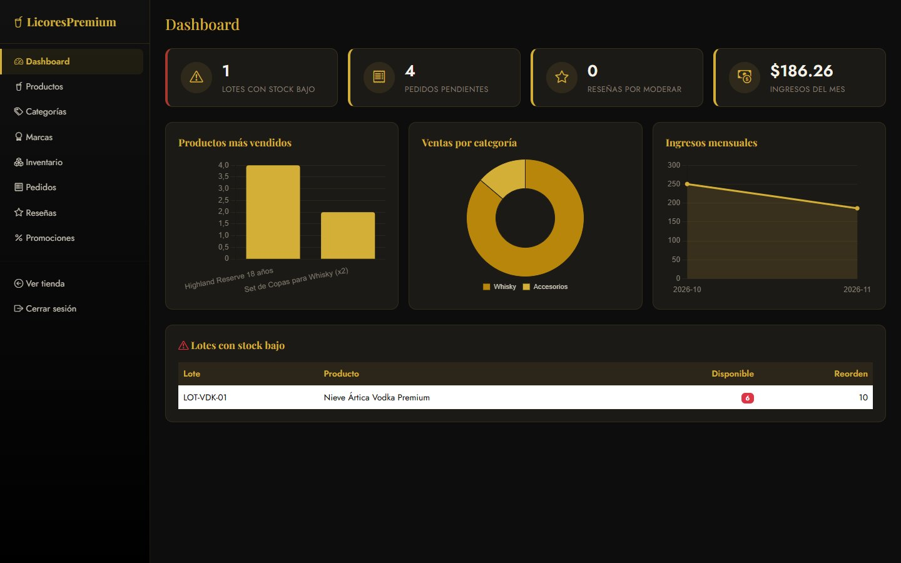

# LicoresPremium — Tienda Virtual de Licores Premium

Tienda virtual B2C de licores premium: verificación +18 al registrarse y comprar,
catálogo con fichas de producto detalladas (origen, graduación alcohólica,
notas de cata, maridaje), carrito dinámico por AJAX con recomendaciones
cruzadas, checkout con opción de regalo, reseñas de productos y panel
administrativo con dashboard de ventas.

## 🎬 Demo en video

Tutorial paso a paso (vertical, ~20 s) con las pantallas del sistema real:

[](docs/video/tutorial-licores-premium.mp4)

▶️ **[Ver el video tutorial](docs/video/tutorial-licores-premium.mp4)**

## 📸 Capturas

| | |
|---|---|
|  |  |
| *Portada con botella animada* | *Catálogo con filtros* |
|  |  |
| *Ficha de producto* | *Panel administrativo* |

## Stack

- **Backend:** Python + Flask (arquitectura MVC)
- **Base de datos:** PostgreSQL + SQLAlchemy (ORM) + Flask-Migrate (Alembic)
- **Autenticación:** Flask-Login (roles cliente/admin, panel admin separado)
- **Vistas:** Jinja2 + Bootstrap 5 + Chart.js
- **Carrito:** basado en sesión de Flask, actualizado vía AJAX (fetch)

## Estructura (MVC)

```
app/
├── models/          # Modelos SQLAlchemy (M)
├── controllers/     # Blueprints de Flask (C)
├── templates/        # Vistas HTML — tienda pública + panel admin separado (V)
├── static/            # CSS (paleta "bar premium") y JS (carrito AJAX + Chart.js)
└── utils/               # Decoradores (edad/admin), carrito en sesión, helpers
config.py
run.py
seed.py                    # Datos de ejemplo para desarrollo
```

## Instalación

```bash
python -m venv venv
venv\Scripts\activate          # Windows
pip install -r requirements.txt

createdb tienda_licores_premium
cp .env.example .env           # y completar DATABASE_URL / SECRET_KEY

flask --app run.py db init
flask --app run.py db migrate -m "Esquema inicial"
flask --app run.py db upgrade

python seed.py                 # usuarios, categorías, productos y promociones de ejemplo
flask --app run.py run --debug
```

## Usuarios de prueba (creados por `seed.py`)

| Rol    | Email                         | Contraseña   |
|--------|--------------------------------|--------------|
| Admin  | admin@licorespremium.com       | admin123     |
| Cliente| cliente@licorespremium.com     | cliente123   |

## Flujo de la tienda

1. **Mayoría de edad**: el catálogo, las fichas y el carrito se navegan libremente. La verificación +18 ocurre al **registrarse** (fecha de nacimiento real) y el login marca la sesión como verificada, por lo que el checkout sigue protegido. La pantalla `/verificar-edad` se conserva y es el destino del checkout si una sesión no está verificada.
2. **Catálogo** (`/catalogo`): filtros por categoría, marca, rango de
   precio, graduación alcohólica mínima y buscador de texto libre.
3. **Ficha de producto** (`/producto/<slug>`): origen, graduación, notas de
   cata, maridaje, disponibilidad, reseñas y recomendaciones "compra
   también" (accesorios como copas, hielo o mixers).
4. **Carrito** (`/carrito`): agregar/actualizar/eliminar vía AJAX sin
   recargar la página; persiste en sesión (funciona sin cuenta).
5. **Checkout** (`/checkout`, requiere cuenta): dirección de envío, opción
   "Es un regalo" con empaque especial y mensaje personalizado, cálculo de
   envío + IVA, descuento de inventario por lote al confirmar.
6. **Panel administrativo** (`/admin`, solo rol `admin`): dashboard con
   KPIs y gráficos Chart.js (productos más vendidos, ventas por categoría,
   ingresos mensuales), CRUD de productos/categorías/marcas, inventario con
   alertas de stock bajo por lote/añada, gestión de pedidos, moderación de
   reseñas y promociones.

## Diseño visual

| Color | Hex | Uso |
|---|---|---|
| Oro | `#D4AF37` | Títulos, bordes, botones |
| Cobre | `#B8742A` | Licor de la botella, degradados |
| Carbón | `#0B0A09` | Fondo general |
| Blanco hueso | `#F5F1E8` | Texto sobre fondo oscuro |

Tipografía **Playfair Display** (títulos) + **Jost** (texto). La portada tiene una botella ilustrada en SVG con el licor ondulando, burbujas que suben, halo y anillo dorado giratorio; una marquesina de categorías en movimiento, tarjetas de producto con zoom y botón "Ver detalle" al pasar el mouse, sección de beneficios y banner de ofertas.

**Animaciones** (`app/static/css/animaciones.css` + `app/static/js/animaciones.js`):
contadores que suben desde 0 en los indicadores, elementos que flotan,
destello en los botones principales, paneles que aparecen al hacer scroll y
puntos "en vivo". Todas se desactivan solas si el usuario tiene activada la
opción del sistema operativo de **reducir movimiento**.
